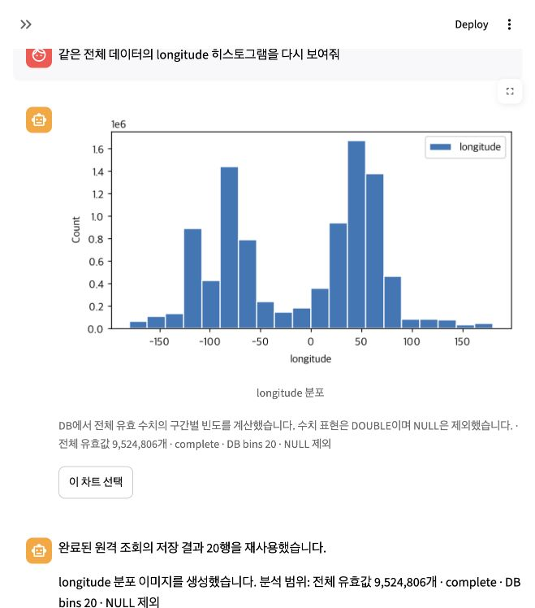

# 전체 원본 히스토그램의 DB 집계와 실제 웹 검증

2026-10-12 KST. Databricks + 로컬 Ollama gemma4:e4b. 회사 Azure/Windows 운영 검증 및 범용 GO와 구분한다.

## 수정한 실행 경로

LLM이 자연어 요청에서 출처·컬럼·모집단·표현을 판단하고 실제 등록 도구를 선택한다. 단순 수치 원본 히스토그램에는 `analyze_source_histogram`을 제공한다. 이 도구가 관측 스키마와 확정 목표를 검증한 뒤 기존 `query_databricks`의 읽기 전용 검사·영속 실행 장부·연결 식별·제출 불명 재실행 차단을 그대로 사용한다. SQL을 계획하는 것과 실제 완료 receipt를 구분한다.

원본에서 값마다 빈도를 반환하던 방식은 연속형 고유값이 많으면 100,000행 제한에 잘릴 수 있었다. 새 도구는 DB에서 min/max/유효 행수와 균등 구간별 COUNT를 계산해 2~100행만 반환한다. 원본은 전송하거나 교체하지 않는다. 최대값은 마지막 구간에 포함하며, 빈 구간은 0으로 복원한다. 상수·NULL·필터·OR·양 끝 경계를 검증한다. DOUBLE 수치 표현과 NULL 제외는 화면에 명시한다. 표본이나 고유값 통계를 전체 원본 분포로 표시하지 않는다.

이 도구는 단순 수치·단일 출처·단일 축을 지원한다. 범주형, 조인, 그룹별 분포, 키별 최신행, 사용자 Python, 축 제한은 기존 별도 도구로 처리한다. 보유 결과만 분석하는 요청을 원격 전체 범위로 확대하지 않는다. 재사용 가능한 완전한 원본은 기존 로컬 경로를 우선한다. 수동 승인 모드에는 이 자동 실행 복합 도구를 등록하지 않는다.

동일 연결·동일 SQL의 완전한 결과와 실제 완료 receipt가 있으면 재사용한다. 명시한 fresh 요청은 1회 새 조회한다. SQL·빈도 합계·구간·출처·모집단·PNG가 검증돼야 완료 카드로 저장된다. 잘린 결과, 비정수/중복 구간, 합계 불일치, 부모가 있는 위조 집계, 잘못된 출처/조건, 실행 receipt가 없는 결과는 거절한다.

## 검증 중 발견해 함께 수정한 문제

- MySQL `CAST ... AS SIGNED` 결과를 답변 렌더러가 Databricks 문법으로 읽던 문제: 실제 backend dialect를 전달한다.
- 복합 조회 실패가 일반 원격 실패 차단에 포함되지 않던 문제: 불명확한 제출 뒤 다른 도구로 자동 재조회하지 못하도록 동일한 실패 경로에 연결한다.
- 재사용 관찰의 호출 ID가 실제 조회 장부 ID와 다를 때 상태 조회가 실패할 수 있던 문제: 실제 완료 receipt ID를 참조한다.
- 재사용 결과를 새 조회처럼 안내하던 문구: 저장 결과 재사용과 신규 조회를 구분한다. `show_chart`도 저장된 이미지 표시로 안내한다.
- 음수 축의 Unicode minus가 일부 macOS 폰트에서 누락됨: 음수 눈금에 ASCII minus를 사용한다.

## 독립 Databricks 검증

출처 `workspace.default.stormtrooper`, 컬럼 `longitude`는 이 평가의 입력이며 제품 코드에 고정하지 않았다.

- 전체/유효 행수: **9,524,806 / 9,524,806**.
- 전송된 집계: **20행**.
- 별도 SQL: 각 구간의 조건을 직접 `SUM(CASE WHEN …)`로 계산한다. 제품의 window/bucket 표현식을 복제하지 않는다.
- 모든 구간 빈도와 전체 합계가 일치했다. NULL 제외, 최댓값 포함, 실제 PNG도 확인했다.
- 직접 probe 11.257초는 agent 실행 시간/조회 수에 합산하지 않는다. 초기 probe의 oracle가 NumPy scalar repr을 SQL에 사용해 실패한 뒤 Python float literal로 수정했다. 이 평가 도구 오류를 제품 실패로 분류하지 않는다.

## 실제 브라우저 실행

기존 대화 `447563e5`와 자산을 보존했다. 06시의 미완료 4회는 이 성공에 합산하지 않으며 [이전 기록](report.md)에 남아 있다.

| 실행 | 실제 입력 | 상태 | 새 원격 조회 | 시간 |
| --- | --- | --- | --- | --- |
| 555e150a64b4498c8f963e60c601a9ac | 전체 데이타에 대해서 longitude 의 histogram을 그려줘 | 완료, 전체 PNG 표시 | 1 | 165.749초 |
| a8d36aa6e92c49efbef19e568a29c9a1 | 같은 전체 데이터로 longitude histogram을 다시 보여줘 | 완료, 동일 집계 재사용 | 0 | 109.750초 |

두 실행 모두 실제 LLM이 `analyze_source_histogram`을 선택했다. 각각 범위 audit 1회 통과 후 완료됐다. 각 차트의 20개 빈도는 독립 CASE oracle와 같았으며 이전 10행 미리보기 차트를 전체 결과로 채점하지 않았다. 첫 실행은 모델 역할 8회, 후속은 7회였다. 기존 call/time 한도와 설정을 늘리지 않았다.

초기 두 실행 이후 재사용 문구·receipt 상태 조회를 추가 보강했다. 마지막 빌드의 재시작 후 브라우저 결과와 회귀 결과는 아래에 별도로 기록한다.

## 판정과 제한

전체 원본 수치 히스토그램의 실제 조회·이미지 생성과 동일 결과 재사용을 입증했다. 기존 원본 3자산, 2 Parquet 파일의 SHA256 및 선택 상태가 불변이었다.

로컬 모델 지연은 여전히 크다. 최초 165.749초는 180초 제한에 근접한다. 이 두 번의 성공으로 반복 신뢰도·모든 EDA·회사 Azure/Windows까지 GO라고 판단하지 않는다. 날짜 조건, 그룹/조인/최신행, 대규모 로컬 복원 예산, 더 긴 대화와 회사 실제 연결은 해당 여정으로 별도 평가해야 한다.

## 마지막 빌드의 재시작 후 결과

- 실제 웹 `4b04edc9b33e41f991c232a27ce516f2`: “같은 전체 데이터의 longitude 히스토그램을 다시 보여줘” → **완료, 98.546초, 모델 7회, 신규 원격 조회 0회**. LLM이 복합 도구를 선택했고 실제 완료 receipt의 저장 결과를 재사용했다. 화면에 재사용 문구와 전체 9,524,806개 PNG를 확인했다.
- 현재 참조하는 조회 장부 ID는 실제 `completed` 기록이다. 실행 상태 조회, 명시적 fresh, 잘못된 조건·위조 이미지, 제출 불명 후 재조회 차단, 완전한 로컬 원본 우선 재사용을 회귀로 검증했다.
- 최종 관련 회귀 **164 PASS (25.351초)**. 중첩 실행 횟수는 합산하지 않았다. `git diff --check`와 서버 health 통과.
- 독립 CASE oracle와 새 차트의 모든 구간 빈도가 일치한다. 기존 3자산/2파일/선택 상태 불변. `.env`·자격증명·call/time 한도 변경 및 commit/push 없음.
- [구조화된 증거](source_bins_verification.json), [테스트 로그](source_bins_tests.txt), [최종 실제 화면](source_bins_web_final.png).

최종 안전한 진단 보강: 검증된 cached receipt를 실행 증거로 인정해 `NO_TOOL_EXECUTION_OBSERVED` 오탐을 제거했다. 집중 진단 테스트 **8 PASS/2.762초**(앞선 164개 실행과 중복되므로 합산하지 않음). 실제 마지막 실행 요약은 answered, 새 조회0, 재사용1, 진단 flags=[]다. 진단 변경을 적용해 8504 서버를 마지막으로 재시작했다.
